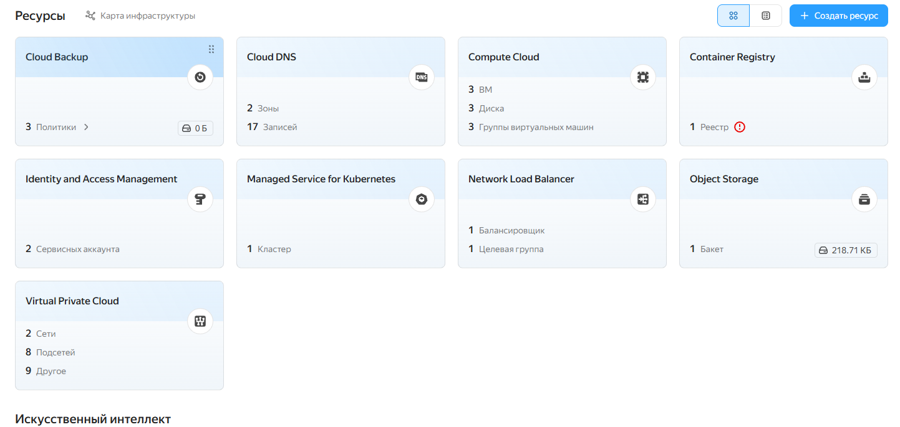
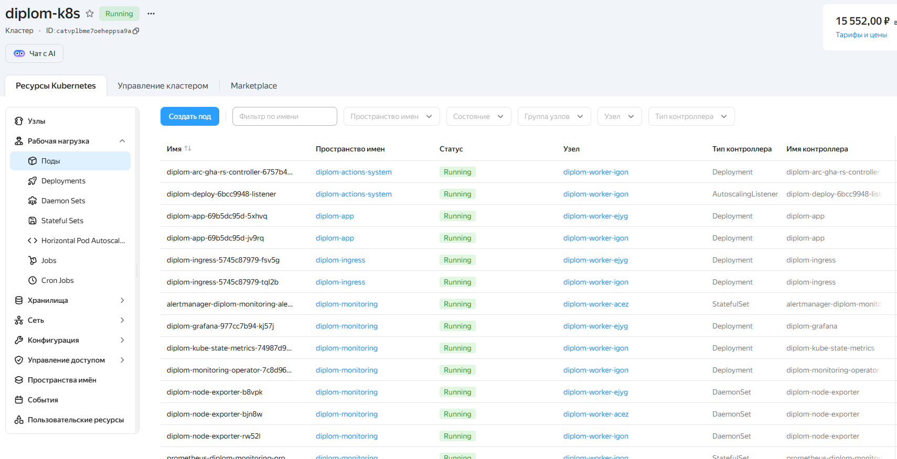
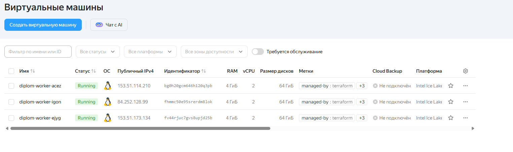
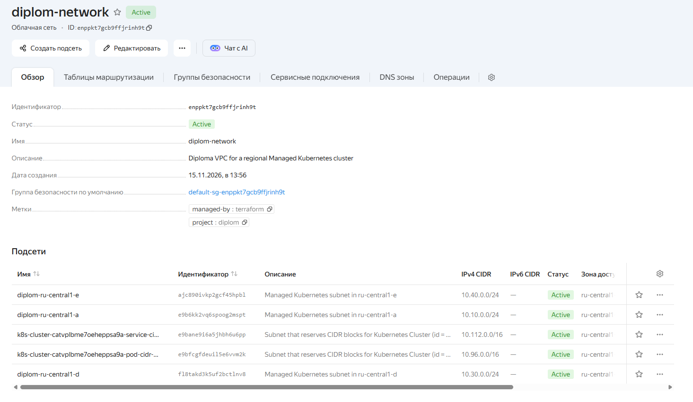
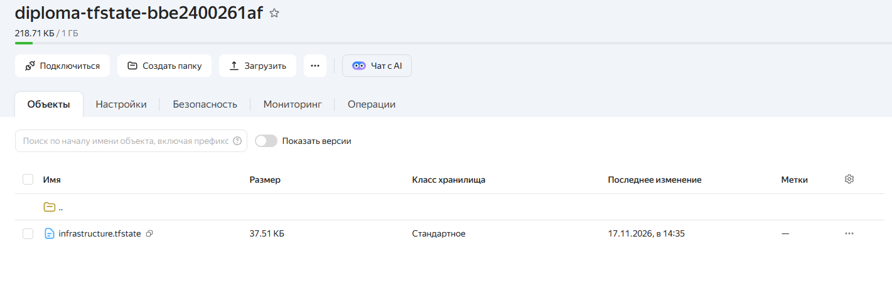
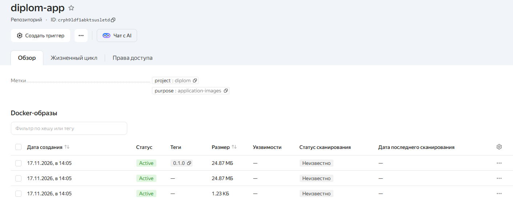
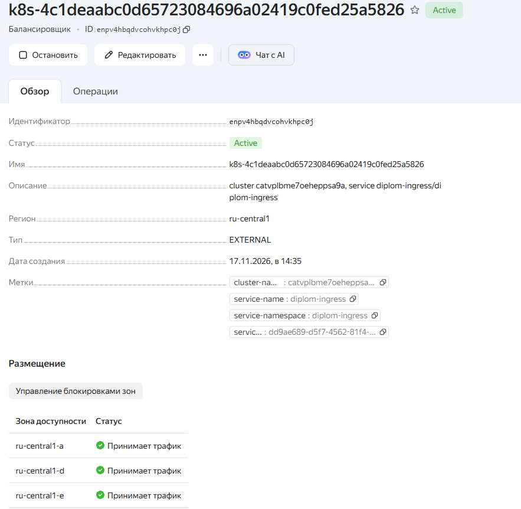
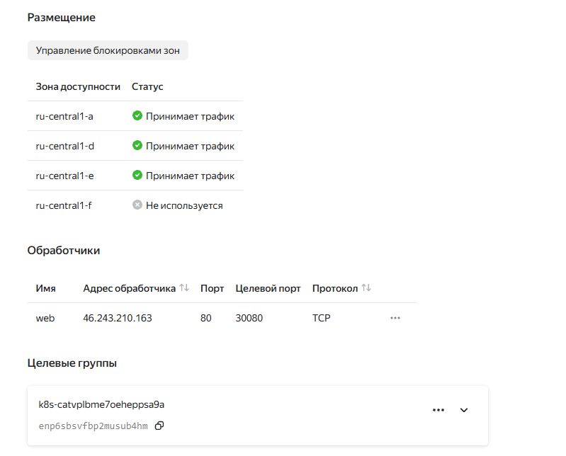

# Скриншоты облачной инфраструктуры

Снимки выполнены владельцем 17 ноября 2026 года около 17:52–17:53 по Europe/Samara. Все восемь оригиналов перенесены без изменения содержимого; SHA256 копий сверены с исходными файлами.

## Ресурсы каталога

Обзор Yandex Cloud показывает кластер, три рабочие ВМ и диска, реестр образов, бакет и общий балансировщик.

На обзорном экране учитываются и ранее существовавшие ресурсы каталога. Для диплома используется один облачный аккаунт `diplom-terraform`; второй аккаунт `service-acc` существовал до начала работы и не изменяется.

## Kubernetes и рабочие узлы

Кластер `diplom-k8s` Running; в списке видны приложение, мониторинг, входной контроллер и служебные компоненты GitHub Actions.

Три рабочие ВМ Running: по 2 vCPU, 4 ГиБ RAM и диску 64 ГиБ.

## Сеть

Сеть `diplom-network` и подсети диплома в a/d/e. Дополнительные подсети с префиксом `k8s-cluster-` созданы Managed Kubernetes для диапазонов подов и сервисов.

## Terraform state

В Object Storage виден объект `infrastructure.tfstate`. Полный настроенный ключ backend — `diploma/infrastructure.tfstate`. Имя бакета оставлено по решению владельца.

## Образ приложения

Container Registry, репозиторий `diplom-app`: первоначальный образ с тегом `0.1.0` активен. Последующие сборки GitHub Actions фиксируются отдельно в отчёте CI/CD.

## Публичный HTTP-вход

Общий Network Load Balancer Active, трафик принимается в a/d/e. Облачное имя с префиксом `k8s-` сгенерировано контроллером Kubernetes.

Обработчик `46.243.210.163:80` направляет TCP-трафик на NodePort 30080. Показана целевая группа узлов.

Метрики и дашборды находятся в [отдельной галерее Grafana](04-gallery.md). Фактические проверки и журналы приведены в отчётах этапов 1–4.
