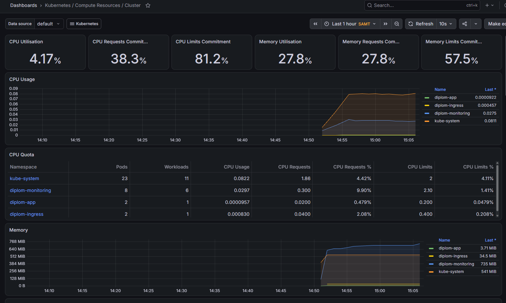
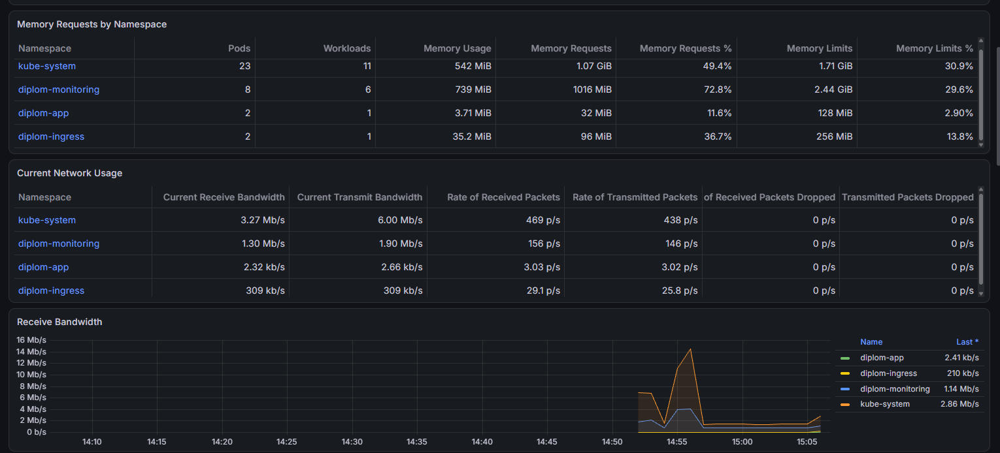
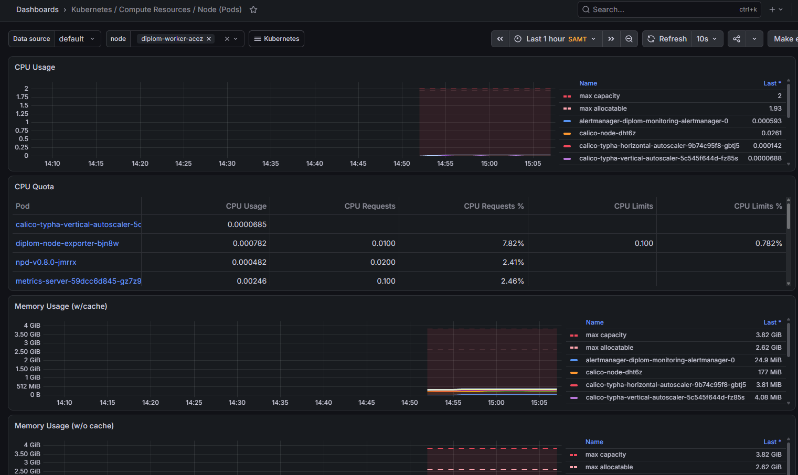
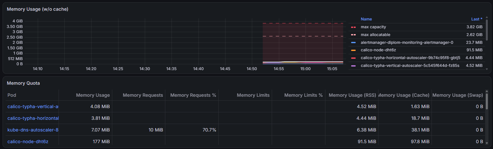
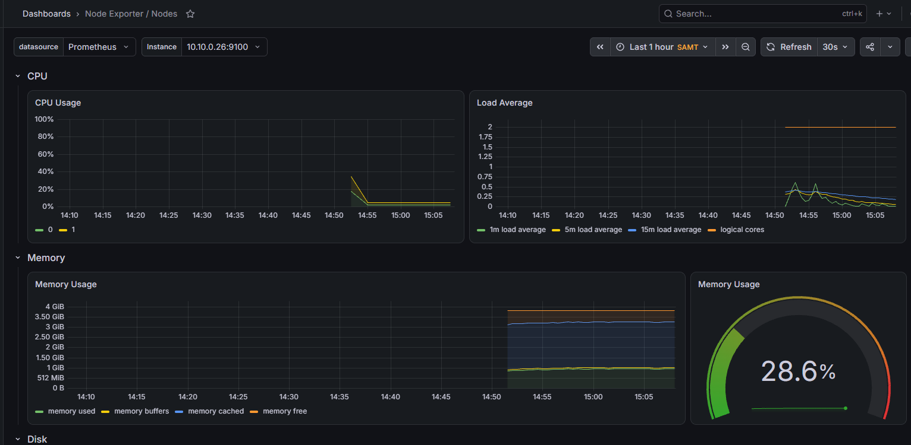
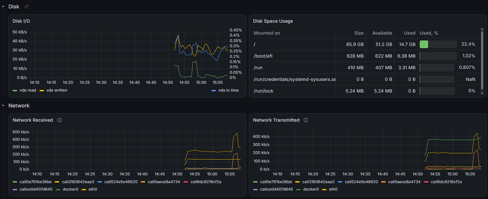

# Скриншоты мониторинга

Снимки выполнены владельцем 17 ноября 2026 года около 15:06–15:08 по времени Europe/Samara. Исходные изображения перенесены без изменений; контрольные суммы копий сверены с оригиналами.

## Состояние кластера

Дашборд `Kubernetes / Compute Resources / Cluster`: загрузка CPU и памяти, квоты по пространствам имён и работающие компоненты диплома.

Дополнительные панели того же дашборда: запросы памяти по namespace, текущий сетевой трафик и входящая пропускная способность.

## Поды рабочего узла

Дашборд `Kubernetes / Compute Resources / Node (Pods)`, узел `diplom-worker-acez`: использование и квоты CPU, использование памяти подами.

Продолжение: память подов и соответствующие квоты.

## Метрики node-exporter

Дашборд `Node Exporter / Nodes`, instance `10.10.0.26:9100`: загрузка CPU, load average и использование памяти.

Продолжение: дисковые операции, занятое место и сетевой трафик. Строка виртуальной файловой системы с размером 0 B показывает `NaN` для процента; это не показатель заполнения системного диска. Для корневой файловой системы `/` на снимке занято 22,4%.

Снимки подтверждают наличие реальных метрик Kubernetes и node-exporter в Grafana. Публичный HTTP-адрес, состояние подов и Helm-релизы дополнительно подтверждены [фактической проверкой](04-cloud-validation.md). Скриншоты приложения и GitHub Actions оформляются отдельно.
